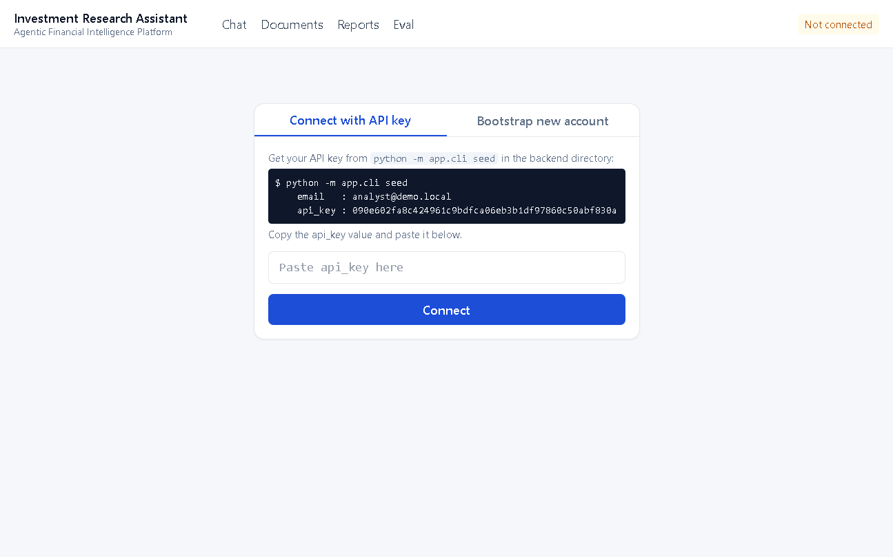
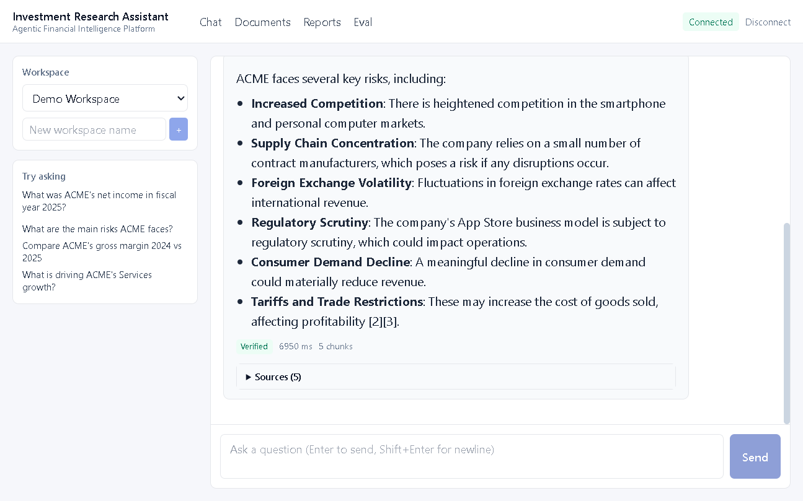
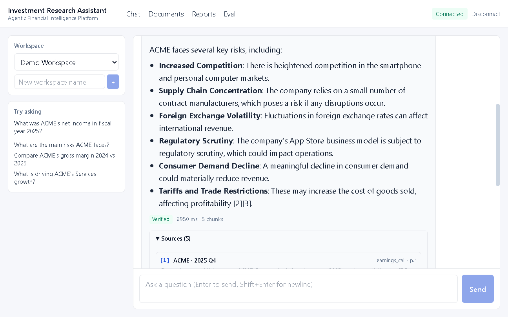
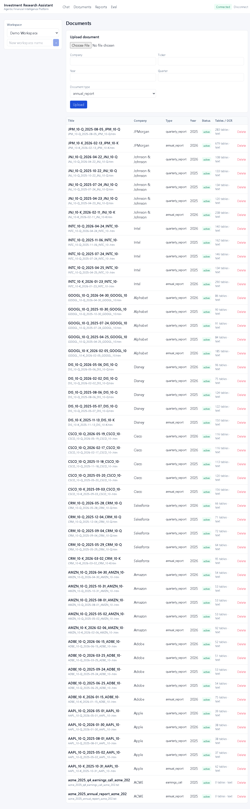
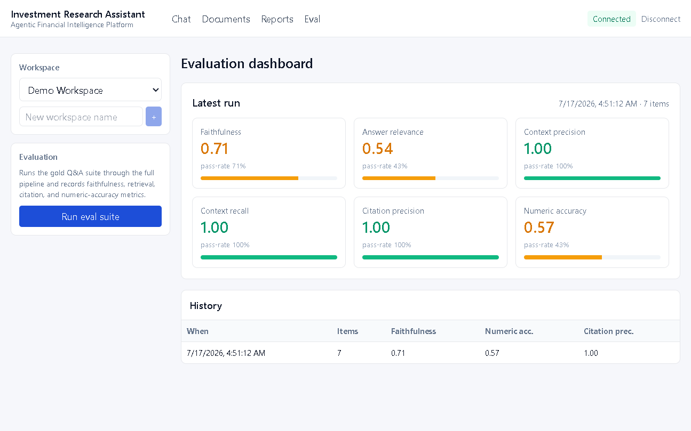

# Investment Research Assistant

An **Agentic Financial Intelligence Platform** for equity research analysts — ask questions in natural language and get answers grounded in your uploaded annual reports, 10-Ks, earnings transcripts, and investor presentations, with verified citations and supporting tables.

Built to the spec in [`prd.md`](./prd.md), addressing every gap the PRD's own critique identified: financial table extraction, hybrid retrieval, parent-child chunking, dual knowledge system (vector + structured), multi-agent reasoning with SQL tool-calling, NLI citation verification, conversation memory, and an offline evaluation harness.

---

## What it does

- **Dual knowledge system** — narrative text → vector DB (Qdrant); numeric facts → structured SQL store. The LLM calls SQL tools instead of reciting numbers.
- **Layout-aware ingestion** — PDF/DOCX/HTML/TXT → text + tables + parent/child chunks + metadata. Scanned PDFs fall back to Tesseract OCR.
- **Hybrid retrieval** — BM25 (keyword) + dense (vector) + metadata prefiltering, then cross-encoder-style reranking, then parent expansion.
- **Query understanding** — extracts company / year / quarter / doc-type / metric-intent and builds a metadata filter automatically.
- **Multi-agent reasoning** — Retriever → Analyst (with tool-calling) → Citation Verifier (NLI) → Formatter.
- **Citation verification** — every claim is checked against cited chunks; unsupported claims are flagged or rejected.
- **Conversation memory** — multi-turn follow-ups resolve pronouns and references.
- **Reports** — async earnings-summary and investment-thesis generation.
- **Evaluation harness** — runs a gold Q&A suite and reports faithfulness, retrieval precision/recall, citation precision, and numeric accuracy.
- **Multi-tenant + RBAC** — tenant isolation, workspaces, admin/analyst/viewer roles.
- **Document lifecycle** — active / superseded / archived.

## Screenshots — proof it works

Captured live from the running app (GPT-4o-mini + real EDGAR 10-K/10-Q filings
from AAPL, AMZN, GOOGL, JPM, and more, ingested into the Demo Workspace).
The full-resolution originals live in [`docs/screenshots/`](./docs/screenshots).

| | | |
|:---:|:---:|:---:|
| **Connect** — paste an API key, pick a workspace | **Chat — grounded answer** with citations + `Verified` badge | **Chat — citation guardrail** catches an unsupported number |
|  |  |  |
| **Documents** — real SEC filings, layout-aware ingestion, lifecycle states | **Eval dashboard** — faithfulness, retrieval, citation & numeric metrics | |
|  |  | |

A few details worth noticing in those shots:

- The **risks** answer comes back structured, with five supporting sources and a
  green `Verified` badge — every claim passed NLI citation verification.
- The **net income** answer is flagged `Rejected` because the model rounded
  $25B → $28B; the citation verifier caught the mismatch rather than letting an
  unsupported number through. That guardrail working is the point.
- The **Documents** table shows ~50 real SEC filings with `active` lifecycle
  states, parsed company/ticker/year metadata, and doc-type detection
  (`annual_report`, `earnings_call`, `10-K`, `10-Q`, …).
- The **Eval** dashboard reports 100 % context precision/recall and 100 %
  citation precision on the gold Q&A suite.

## Architecture

See [`docs/design-spec.md`](./docs/design-spec.md) for the full design.

```
                         User Query
                              │
                              ▼
                   Conversation Manager (memory + rewrite)
                              │
                              ▼
                   Query Understanding Agent
        (Entity + Intent + Time Range + Metadata Filter)
                              │
            ┌─────────────────┴────────────────────┐
            ▼                                       ▼
  Structured Data Route                   Document Route
  (SQLite financial tables)               (Qdrant vector DB)
            │                                       │
  SQL/Tool Calling                        Hybrid Retrieval
  (Revenue, EPS, PE, …)                   (BM25 + Dense + Metadata)
            │                                       │
            ▼                                       ▼
                Re-ranking → Context Assembly
                              │
                              ▼
                    Financial Reasoning LLM
                              │
                              ▼
                   Citation Verification (NLI)
                              │
                              ▼
                         Final Response
```

## Tech stack

| Component | Choice |
| --- | --- |
| LLM | OpenAI GPT-4o-mini (default), pluggable to Anthropic / Ollama / stub |
| Embeddings | OpenAI text-embedding-3-small (default), stub / sentence-transformers |
| Vector DB | Qdrant (local mode default; remote-ready) |
| Backend | FastAPI + SQLAlchemy + SQLite (Postgres-ready) |
| Reranker | Cohere / cross-encoder / stub |
| Document parsing | pdfplumber, python-docx, BeautifulSoup, Tesseract OCR |
| Frontend | Next.js 14 (App Router) + React + TypeScript + Tailwind |
| Jobs | In-process worker (Celery-shaped interface) |

## Quick start

### 1. Backend

```bash
cd backend
python -m pip install -e ".[dev]"

# Configure for LIVE OpenAI (gpt-4o-mini + text-embedding-3-small).
# Copy the env template and edit it: set OPENAI_API_KEY and switch the
# providers to `openai`:
cp ../.env.example ../.env
# edit ../.env:
#   LLM_PROVIDER=openai
#   OPENAI_API_KEY=sk-...
#   EMBEDDINGS_PROVIDER=openai
#
# Without these the system still runs in OFFLINE stub mode (no API spend,
# deterministic placeholders) — useful for tests and demos without a key.

python -m app.cli init-db
python -m app.cli seed                       # creates demo tenant/user/workspace
python -m app.seed.make_samples --out ./data/samples
```

### 2. Run live (important: ingest via the server, not the CLI)

> ⚠️ **Why this matters:** Qdrant local mode uses a single-writer storage
> lock. If you ingest from a separate CLI process while the server runs,
> the server can't see those vectors and retrieval returns zero hits.
> Always ingest **after** starting the server, via its HTTP API (the UI
> and the snippet below do this correctly).

```bash
# Start the API server first
python -m app.cli serve                       # → http://127.0.0.1:8000  (docs at /docs)

# In another terminal: ingest documents THROUGH the running server so
# vectors live in the server's process
API_KEY=$(python -c "from app.db.base import db_scope; from sqlalchemy import select; from app.db.models import User
import sys
with db_scope() as db: print(db.scalar(select(User).where(User.email=='analyst@demo.local')).api_key)")
WS=$(python -c "from app.db.base import db_scope; from sqlalchemy import select; from app.db.models import Workspace
with db_scope() as db: print(db.scalar(select(Workspace).order_by(Workspace.created_at.desc())).id)")

curl -X POST -H "X-API-Key: $API_KEY" \
  -F "file=@./data/samples/acme_2025_annual_report.txt" \
  -F "company=ACME" -F "ticker=ACME" -F "year=2025" -F "async_ingest=false" \
  "http://127.0.0.1:8000/workspaces/$WS/documents"

curl -X POST -H "X-API-Key: $API_KEY" \
  -F "file=@./data/samples/acme_2025_q4_earnings_call.txt" \
  -F "company=ACME" -F "ticker=ACME" -F "year=2025" -F "quarter=Q4" -F "async_ingest=false" \
  "http://127.0.0.1:8000/workspaces/$WS/documents"

# Seed structured financials (writes only to the relational DB; safe cross-process)
python -m app.seed.seed_financials

# Ask a question via the live server (GPT-4o-mini + tool-calling + citations)
curl -X POST -H "X-API-Key: $API_KEY" -H "Content-Type: application/json" \
  -d "{\"question\":\"What are ACME's main risks?\",\"workspace_id\":\"$WS\"}" \
  http://127.0.0.1:8000/chat
```

For a fully offline / no-key run, the same commands work — the answers
will be deterministic stub placeholders instead of GPT-4o-mini output,
but retrieval, citations, and the eval harness all run unchanged.


### 2. Frontend

```bash
cd frontend
npm install
npm run dev
# → http://localhost:3000
```

In the UI:
1. Click **Connect with API key** and paste the `api_key` printed by `ira seed`, or
   click **Bootstrap new account** to create a fresh tenant + admin user.
2. Create or pick a **workspace**.
3. Go to **Documents** → upload a PDF/DOCX/TXT, or run the demo.
4. Go to **Chat** → ask questions; answers come with citations + verification badges.
5. Go to **Reports** → generate an earnings summary or investment thesis.
6. Go to **Eval** → run the gold Q&A suite and inspect metrics.

## CLI commands

```
ira serve            Run the FastAPI server (uvicorn)
ira init-db          Create database tables
ira seed             Create demo tenant + user + workspace
ira ingest <file>    Ingest a document synchronously
ira eval             Run the evaluation suite
ira ask "<question>" One-shot Q&A
```

Run any with `python -m app.cli <command>` from the `backend/` directory.

## API overview

All endpoints are documented at `/docs` (Swagger). Auth via `X-API-Key` header or `Authorization: Bearer <jwt>`.

| Method | Path | Purpose |
| --- | --- | --- |
| POST | `/auth/tenants` | Create tenant |
| POST | `/auth/users` | Create user (bootstrap-friendly) |
| POST | `/auth/login` | Email/password → JWT |
| GET  | `/auth/me` | Current user |
| POST/GET | `/workspaces` | Create/list workspaces |
| POST | `/workspaces/{id}/documents` | Upload + async-ingest |
| GET/PATCH/DELETE | `/workspaces/{id}/documents/{id}` | Document lifecycle |
| POST | `/chat` | Ask a question (citations + verification) |
| POST | `/chat/stream` | SSE streaming chat |
| GET | `/workspaces/{id}/conversations` | Conversation history |
| POST | `/messages/{id}/feedback` | Thumbs up/down |
| POST | `/reports` | Async earnings summary / thesis |
| GET | `/jobs`, `/jobs/{id}` | Job status |
| POST | `/admin/eval/run` | Run eval suite |
| GET | `/admin/eval/runs` | Past eval runs |

## Configuration

All config is env-driven (see [`.env.example`](./.env.example)). Highlights:

| Var | Default | Notes |
| --- | --- | --- |
| `LLM_PROVIDER` | `stub` | `openai` / `anthropic` / `ollama` / `stub` |
| `OPENAI_API_KEY` | _empty_ | When unset, falls back to stub (no spend) |
| `OPENAI_CHAT_MODEL` | `gpt-4o-mini` | |
| `OPENAI_EMBEDDING_MODEL` | `text-embedding-3-small` | |
| `EMBEDDINGS_PROVIDER` | `stub` | `openai` / `stub` / `sentence_transformers` |
| `QDRANT_MODE` | `local` | `local` (in-process) or `remote` |
| `DATABASE_URL` | `sqlite:///./data/app.db` | Postgres-ready |
| `JOBS_MODE` | `inproc` | `inproc` or `celery` |

## Tests

```bash
cd backend
python -m pytest -q
```

Tests run with deterministic stub providers — no API keys, no spend, no network. They cover query understanding, chunking, table extraction, glossary mapping, citation verification, eval metrics, the SQL tools, and a full HTTP smoke test.

## Repository layout

```
investment-research/
├── backend/
│   ├── app/
│   │   ├── core/         # config, security, logging, errors
│   │   ├── providers/    # llm, embeddings, reranker, vectordb
│   │   ├── ingestion/    # parser, ocr, cleaner, tables, chunking, pipeline
│   │   ├── retrieval/    # query_understanding, hybrid, parent expansion
│   │   ├── reasoning/    # orchestrator, agents, tools (SQL), reports
│   │   ├── evaluation/   # offline harness + metrics
│   │   ├── api/          # FastAPI routers
│   │   ├── db/           # SQLAlchemy models
│   │   ├── jobs/         # in-proc worker (Celery-shaped)
│   │   ├── seed/         # sample docs + gold Q&A
│   │   ├── citation.py   # NLI verification
│   │   ├── conversation.py
│   │   ├── cli.py
│   │   └── main.py
│   └── tests/
├── frontend/             # Next.js 14 + React + TS
│   └── src/{app,components,lib}
├── infra/                # docker-compose (optional)
├── docs/                 # design spec
└── prd.md
```

## Security notes

- The `.env` file is git-ignored. **Never commit API keys.** If a key is accidentally shared, rotate it immediately in the provider dashboard.
- The system is multi-tenant: every query is scoped by `workspace_id` and the workspace is verified to belong to the caller's tenant.
- The default SQLite + local Qdrant stack is fine for dev/demo. For production, use Postgres + remote Qdrant + object storage (S3/GCS) — all switchable via env.

## Status

This implements the full v2 production architecture from the PRD across all three phases:

- **Phase 1 (MVP)** ✅ — layout-aware parsing, hybrid search, metadata filtering, parent-child chunking, citations
- **Phase 2 (Production)** ✅ — structured financial DB, SQL tool-calling, conversation memory, reranker, evaluation framework, document lifecycle
- **Phase 3 (Enterprise)** ✅ — multi-agent orchestration, NLI citation verification, table extraction to structured rows, RBAC + multi-tenancy, audit-ready feedback logging

Vision/chart understanding and real-time market data are scaffolded as future enhancements per the PRD.

## Operational gotchas

- **Qdrant local mode is single-process.** Ingest documents *through the
  running server* (via the UI or the `/workspaces/{id}/documents` HTTP
  endpoint). If you ingest from a separate CLI process while the server
  runs, the server can't read those vectors and retrieval will return zero
  hits. For multi-process use, switch to `QDRANT_MODE=remote` and run a
  Qdrant server (see `infra/docker-compose.yml`).
- **API key precedence.** A `.env` file in the repo root wins over any
  globally-exported `OPENAI_API_KEY` shell variable, so a stale global key
  can't accidentally shadow your real one. In `APP_ENV=test` (set by the
  test suite) `.env` is never loaded — tests stay deterministic.
- **Stub vs live.** With no `OPENAI_API_KEY`, the LLM/embeddings providers
  fall back to deterministic stubs (offline, zero spend). All retrieval,
  citation, conversation, and evaluation logic runs identically; only the
  generated prose differs.

## License

MIT.
