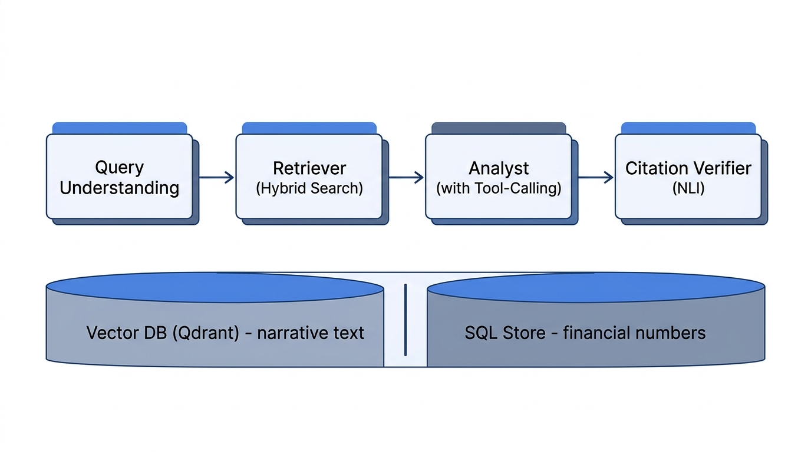
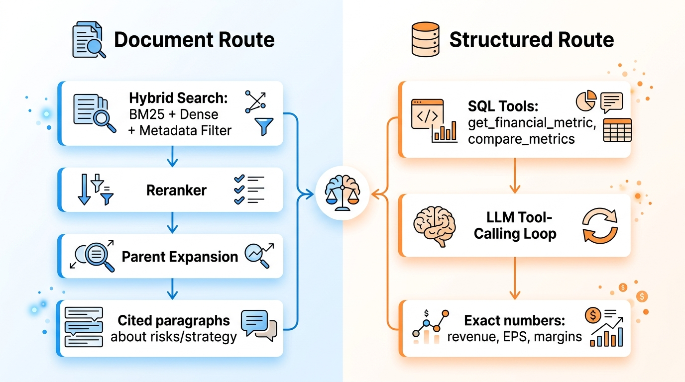
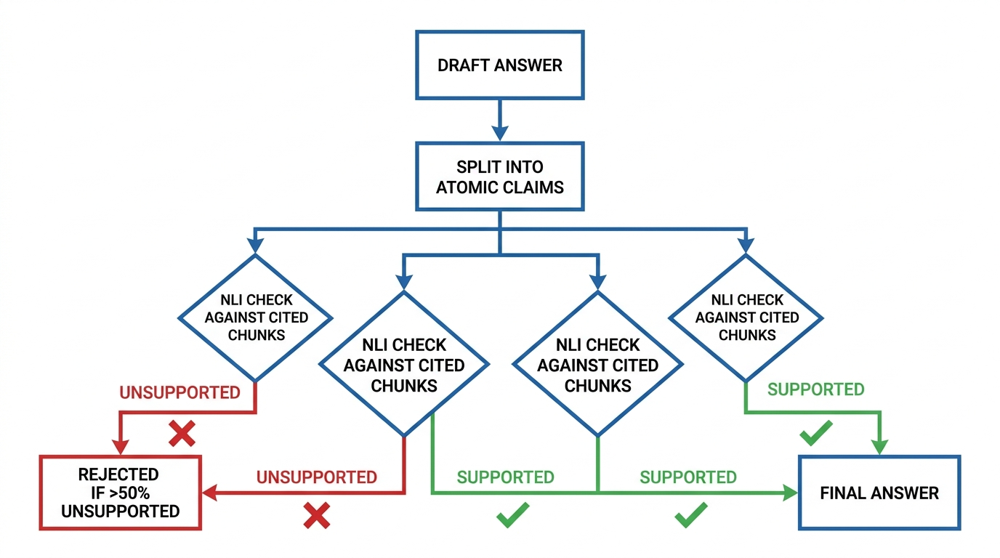
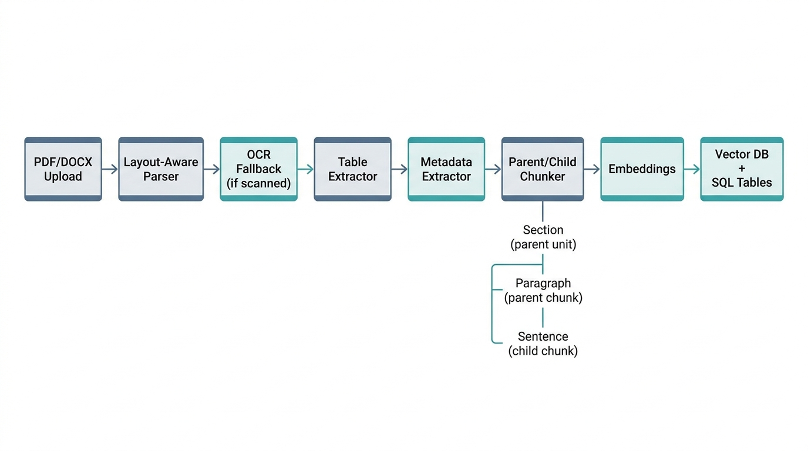
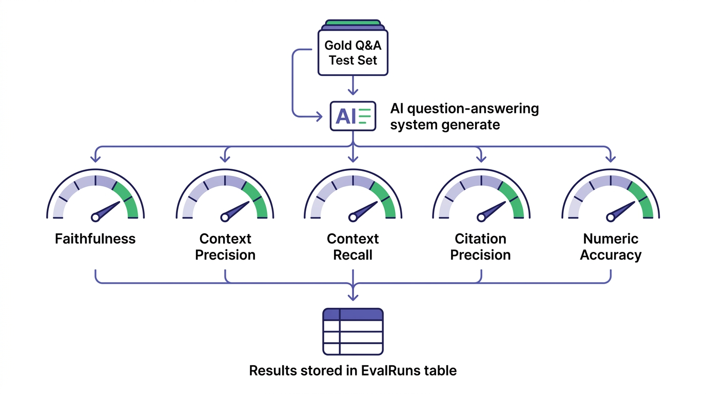
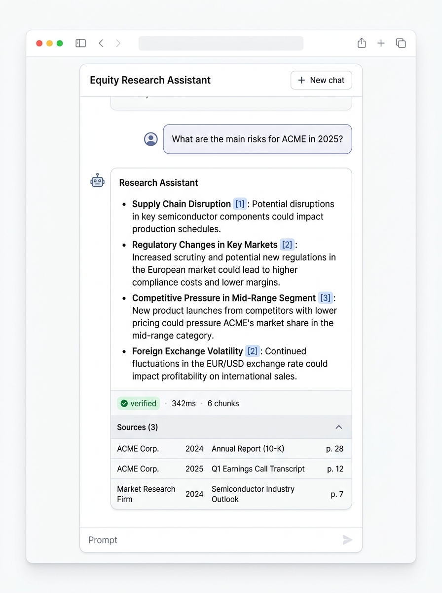

# Building an Agentic Equity Research Assistant: The Architecture Behind Investment Research Assistant

*How I combined hybrid retrieval, multi-agent reasoning, SQL tool-calling, and NLI citation verification into one platform that answers fundamental-analysis questions with evidence, not guesses.*


---

## TL;DR

Most "RAG for PDFs" chatbots stop at the *vector search then LLM* step. That pattern is fine for FAQ retrieval, but it **fails hard** for equity research: numbers drift, financial tables collapse into text soup, and citations end up as ornamental `[1]` markers that guarantee nothing.

This article tears down **Investment Research Assistant**, an agentic research platform I built to fix exactly those failures. What makes it different:

- **Dual knowledge system.** Narrative text goes to a vector DB. Numeric facts go to a SQL store. The LLM calls SQL tools instead of reciting numbers.
- **Multi-agent reasoning.** A pipeline of Query Understanding, Retriever, Analyst with tool-calling, and a Citation Verifier.
- **Real citation verification.** Every atomic claim is checked against the cited chunks through a Natural Language Inference test. Unsupported claims are flagged or rejected.
- **Layout-aware ingestion.** PDF, DOCX, HTML, and TXT parsing, table extraction to structured rows, parent-child chunking, and OCR fallback.
- **Hybrid retrieval.** BM25 plus dense vectors plus a metadata prefilter, followed by a cross-encoder-style reranker and parent expansion.
- **Offline evaluation harness.** Faithfulness, retrieval precision and recall, citation precision, and numeric accuracy are measured automatically.

The stack is **FastAPI plus SQLAlchemy plus SQLite plus Qdrant** on the backend, **Next.js 14 with TypeScript and Tailwind** on the frontend, and a pluggable LLM provider (OpenAI by default, with Anthropic, Ollama, and stub alternatives).

---

## 1. Why vanilla RAG is not enough for equity research

Imagine an analyst asking:

> *"What are the main risks for ACME in 2025, and how does its cash position compare to last year?"*

A naive RAG system trips over **five classic failure modes** for a question like this.

| Failure mode | What goes wrong |
| --- | --- |
| Numbers recited from LLM memory | EPS becomes `$4.32` when the source says `$4.13` |
| Financial tables collapse into prose | Row and column structure is destroyed, totals stop reconciling |
| Time filters are wrong | "outlook 2026" filters to documents dated 2026 that do not exist |
| Citations are pure decoration | A `[1]` marker gives no guarantee the cited chunk supports the claim |
| Comparison queries come back lopsided | One company dominates retrieval and the comparison is unfair |

**Investment Research Assistant** was built to solve all five. Let us walk through how.

---

## 2. The high-level architecture

The design philosophy fits in one sentence: **separate narrative knowledge from numeric knowledge, then reunite them at the reasoning stage under verification.**



The four stages are:

1. **Query Understanding.** Extract entities (company and ticker), time range, document type, and intent. The intent drives routing.
2. **Retriever.** Hybrid retrieval with a metadata prefilter and parent expansion.
3. **Analyst.** An agent with a tool-calling loop. It can call SQL tools for exact numbers.
4. **Citation Verifier.** An NLI check of the draft answer against the cited chunks.

The final output is a rich `AnswerResponse` object rather than a bare string:

```python
# backend/app/reasoning/orchestrator.py
@dataclass
class AnswerResponse:
    answer: str                       # the answer text with [1], [2] markers
    citations: list[dict]             # full source list (company, year, page, snippet)
    plan: dict                        # the QueryPlan the system understood
    tool_results: list[dict]          # trace of SQL tool calls invoked
    verification: dict                # NLI outcome: supported / partial / rejected
    retrieval: dict                   # top chunk scores (dense, bm25, rerank)
    latency_ms: int
    notes: list[str] = field(default_factory=list)
```

The important part: **every field is surfaced in the UI.** A user can open the Sources panel, inspect the Tool calls trace, and see the verification badge. Transparency is a feature, not overhead.

---

## 3. The dual knowledge system: documents versus numbers

This is the most fundamental architectural decision. Many RAG systems try to jam `Revenue Q4 2025 = $4.2B` into a vector DB as text. That is a permanent source of error: numbers cannot be trusted from semantic retrieval.

I split retrieval into two routes.



- **Document route.** Narrative paragraphs about risks, strategy, and outlook go to Qdrant. They are searched through hybrid retrieval.
- **Structured route.** Numbers such as revenue, EPS, margins, and debt go to a SQL table called `StructuredFinancials`. The LLM accesses them through function calling.

### Why this split is powerful

When an analyst asks *"What was ACME's revenue in Q4 2025?"*, the LLM does not need to guess from a text chunk. It calls a tool:

```python
# backend/app/reasoning/tools.py
def get_financial_metric(
    db: Session, *, workspace_id: str, company: str,
    metric: str, fiscal_year: int | None = None, quarter: str = "",
) -> dict:
    company = _normalize_company(company)
    q = select(StructuredFinancial).where(
        StructuredFinancial.workspace_id == workspace_id,
        StructuredFinancial.company.ilike(f"%{company}%"),
        StructuredFinancial.metric == metric,
    )
    if fiscal_year is not None:
        q = q.where(StructuredFinancial.fiscal_year == fiscal_year)
    if quarter:
        q = q.where(StructuredFinancial.quarter == quarter.upper())
    q = q.order_by(StructuredFinancial.fiscal_year.desc(),
                   StructuredFinancial.quarter.desc())
    rows = list(db.scalars(q).all())
    return {"metric": metric, "company": company,
            "results": [_row_dict(r) for r in rows]}
```

The returned value is an **exact number** with its unit, currency, and source page. The LLM never has the opportunity to hallucinate it.

> **Key insight.** The tool description states explicitly: *"This tool only returns NUMERIC data. Do NOT call it for textual content like 'risk_factors', 'strategy'."* This prevents the LLM from abusing the SQL route for narrative topics.

### The four tools exposed to the agent

```python
TOOL_SPECS: list[ToolSpec] = [
    ToolSpec(name="get_financial_metric", ...),   # one metric, one company
    ToolSpec(name="compare_metrics", ...),        # same metric, many companies
    ToolSpec(name="list_metrics", ...),           # available metrics for a company
    ToolSpec(name="list_periods", ...),           # available fiscal periods
]
```

The first is the most common. The second matters for comparative questions. Without it, the LLM would have to merge retrieval hits from many companies, which tends to produce lopsided answers.

---

## 4. Hybrid retrieval: the math behind the document route

This is where most of the retrieval quality lives. The retriever runs three signals in sequence and fuses them with a weighted normalization. Let me state it precisely.

### 4.1 Candidate selection

Given a user question `q`, the retriever first narrows the universe of chunks `C` to a candidate set `C_f` using a metadata filter `f` derived from the `QueryPlan`:

```
C_f = { c in C : company(c) in plan.companies,
                 year(c)    in plan.years,
                 quarter(c) in plan.quarters,
                 doc_type(c) in plan.doc_types }
```

Empty filters are dropped (conjunction with the universal set). The same filter `f` is pushed into both the relational DB query and the Qdrant dense search, so the lexical and dense candidates come from the **same** universe.

### 4.2 BM25 score

BM25 scores a candidate chunk `c` against the query `q` using the standard Okapi formula with parameters `k1` and `b`:

```
BM25(q, c) = sum over terms t in q of  IDF(t)
             * ( f(t, c) * (k1 + 1) )
             / ( f(t, c) + k1 * (1 - b + b * |c| / avgdl) )
```

where `f(t, c)` is the term frequency in the chunk, `|c|` is the chunk length, `avgdl` is the average candidate chunk length, and `IDF(t)` is the inverse document frequency over the candidate set. The implementation uses `rank_bm25.BM25Okapi` over the candidate corpus.

### 4.3 Dense score

The dense score is the cosine similarity between the query embedding and the chunk embedding, both produced by `text-embedding-3-small`. Qdrant returns it in the range `[-1, 1]`:

```
dense(q, c) = cos(emb(q), emb(c))
            = (emb(q) . emb(c)) / (||emb(q)|| * ||emb(c)||)
```

### 4.4 The fusion equation

Both signals are min-max normalized to `[0, 1]` against the per-query maximum, then combined as a convex combination. Let:

```
d_hat(c) = dense(q, c) / max_{c' in C_f} dense(q, c')
b_hat(c) = BM25(q, c)  / max_{c' in C_f} BM25(q, c')
```

The fused score is:

```
fused(c) = w_d * d_hat(c) + w_b * b_hat(c)
```

with weights from `app/core/config.py`:

```python
hybrid_dense_weight: float = 0.6
hybrid_bm25_weight:  float = 0.4
```

Because the weights are normalized (`w_d + w_b = 1.0`) and each input is in `[0, 1]`, the fused score also lives in `[0, 1]`. The top `max(top_k * 2, rerank_top_k * 3)` candidates by `fused` are passed to the reranker.

The exact code is concise:

```python
# backend/app/retrieval/hybrid.py
max_dense = max(dense_by_chunk.values(), default=1.0) or 1.0
max_bm25  = max(bm25_by_chunk.values(),  default=1.0) or 1.0
w_d = self.settings.hybrid_dense_weight   # 0.6
w_b = self.settings.hybrid_bm25_weight    # 0.4

fused: list[tuple[float, Chunk]] = []
for ch in db_chunks:
    d = dense_by_chunk.get(ch.id, 0.0) / max_dense
    b = bm25_by_chunk.get(ch.id, 0.0) / max_bm25
    score = w_d * d + w_b * b
    fused.append((score, ch))
fused.sort(key=lambda t: t[0], reverse=True)
candidates = fused[: max(top_k * 2, rerank_top_k * 3)]
```

### 4.5 Cross-encoder rerank

The reranker scores each `(query, document)` pair jointly, which is more accurate than the late-interaction fusion above because the model attends to query and document tokens together. The result is a list of `(index, score)` pairs.

For each candidate position `i`, the final rerank score is:

```
rerank(i) = cross_encoder(q, text(c_i))
```

with defaults `retrieval_top_k = 10` and `reranker_top_k = 5`. The system also ships a `StubReranker` that uses Jaccard overlap as a deterministic fallback so the pipeline still runs offline:

```python
# backend/app/providers/reranker.py
inter = len(qtoks & dtoks)
union = len(qtoks | dtoks) or 1
score = inter / union
```

### 4.6 The finance-specific section boost

This is the small detail that makes risk and outlook questions work. Pure lexical and dense rankers miss a structural signal: a question like *"What are the risks?"* should surface the `RISK FACTORS` section even when its vocabulary barely overlaps the question.

When the question matches a canonical section keyword, chunks whose section header contains that keyword get an additive bump:

```
final(i) = rerank(i) + 0.5 * 1[ section(c_i) contains section_boost(q) ]
```

The rules are deterministic and finance-aware:

```python
# backend/app/retrieval/hybrid.py
rules = [
    ("RISK", ["risk", "headwinds", "threats", "concerns"]),
    ("OUTLOOK", ["outlook", "guidance", "forecast", "future", "2026", "2027"]),
    ("STRATEGY", ["strategy", "strategic", "initiative"]),
    ("CASH FLOW", ["cash flow", "capex", "capital expenditure"]),
    ("BALANCE SHEET", ["balance sheet", "debt", "liabilit", "equity"]),
    # ... etc
]
```

The `+0.5` constant is large enough to push a section-matched chunk past most non-matched chunks, which is what we want for structured questions.

### 4.7 Parent expansion

After ranking, each surviving child chunk is expanded to its parent for the LLM context. The math here is purely structural: child chunks have a `parent_id` foreign key, and a small cache prevents re-fetching the same parent twice.

---

## 5. Multi-agent reasoning with the tool-calling loop

The heart of the system is `run_tool_loop`. It is a deliberately small loop that calls the LLM with tools enabled, then **disables tools after the first call** so the model is forced to synthesize rather than keep poking tools.

```python
# backend/app/reasoning/agents.py
def run_tool_loop(
    llm: BaseLLM, messages: list[Message],
    tools: list[Any], dispatch: Any, *,
    max_iterations: int = 3,
) -> tuple[str, list[dict]]:
    """Loop the LLM through tool-calling until it produces a final answer
    or hits the iteration cap."""
    tool_results: list[dict] = []
    msgs = list(messages)
    for _ in range(max_iterations):
        # Disable tools after the first call so the model must synthesize.
        result = llm.chat(
            msgs,
            tools=tools if not tool_results else None,
            temperature=0.1,
        )
        if not result.tool_calls:
            return result.content, tool_results
        for tc in result.tool_calls:
            try:
                out = dispatch(tc["name"], tc["arguments"])
            except Exception as e:
                out = {"error": f"{type(e).__name__}: {e}"}
            tool_results.append({
                "name": tc["name"],
                "arguments": tc["arguments"],
                "result": out,
            })
        msgs.append(Message(
            role="assistant",
            content=result.content or "",
            _tool_calls=result.tool_calls,
        ))
        for tc, tr in zip(result.tool_calls,
                          tool_results[-len(result.tool_calls):]):
            msgs.append(Message(
                role="tool",
                tool_call_id=tc["id"],
                name=tc["name"],
                content=f"Tool {tc['name']} returned: "
                        + _truncate_json(tr["result"]),
            ))
    # Final synthesis pass with no tools available
    final = llm.chat(msgs, tools=None, temperature=0.1)
    return final.content, tool_results
```

A few non-obvious details:

- **`tools=None` after the first tool call** is a discipline strategy. It prevents the LLM from calling tools again and again to avoid synthesizing.
- **`temperature=0.1`** because financial numbers need determinism.
- **`max_iterations=3`** is a hard ceiling. Without it, an agent can loop calling tools indefinitely.
- **`_truncate_json`** trims large SQL tool outputs to roughly 2000 characters before they re-enter the context window. This is what prevents `context_length_exceeded` errors on large documents.

### The comparison fan-out

Comparative questions such as *"Compare operating margin for Apple, Microsoft, and Google in 2025"* have a hidden trap. Hybrid retrieval tends to return chunks from only one dominant company, so the comparison ends up unfair.

The fix is a **per-company fan-out**. The orchestrator detects `is_comparison` and `len(plan.companies) >= 2`, then runs one retrieval per company and merges.

```python
# backend/app/reasoning/orchestrator.py
if plan.is_comparison and len(plan.companies) >= 2:
    retrieval = _comparison_retrieve(
        retriever, rewritten, plan,
        per_company=3, total_cap=8,
    )
    notes.append(f"comparison fan-out: {len(plan.companies)} companies")
else:
    retrieval = retriever.retrieve(rewritten, plan=plan)
```

Mathematically, the merged set is the union of per-company top-k lists, de-duplicated by `chunk_id`, capped at `total_cap = 8`:

```
M = dedupe( union over c in plan.companies of  top_k(retrieve(q, plan pinned to c), k=3) )
M = M[:8]
```

The result is balanced sources across all named companies rather than only the global top hits.

---

## 6. Citation verification with NLI: citations as guarantees

The original PRD criticized this sharply: *"Citations are just format, not a guarantee of correctness."* I took that seriously. Every draft answer passes through `CitationVerifier` before it is returned.



The logic is:

1. Split the draft into **atomic claims** (roughly one sentence each).
2. For each claim, test whether it is **entailed** by at least one cited chunk.
3. If **more than 50 percent of claims are unsupported**, mark the answer `REJECTED` and warn the user.

### The entailment test

The entailment predicate `Entails(claim, context)` is implemented in two interchangeable ways:

```python
# backend/app/citation.py
class CitationVerifier:
    def _check_claims(self, claims, context):
        # Prefer the LLM judge when available; otherwise fall back to overlap.
        if self.llm is not None and self.llm.name not in {"stub", "base"}:
            try:
                return self._llm_judge(claims, context)
            except Exception:
                pass
        return self._heuristic_judge(claims, context)
```

The **heuristic judge** is a deterministic lexical entailment proxy. Let:

```
T(claim)   = set of alphanumeric tokens in the claim (lowercased)
T(context) = set of tokens in the cited context
N(claim)   = set of numeric strings in the claim
```

A claim is supported when both:

```
overlap(claim) = |T(claim) ∩ T(context)| / |T(claim)|         >= 0.55
number_ok(claim) = |{ n in N(claim) : n is in context }|
                   / |N(claim)|                                >= 0.50
```

The numeric check understands that numbers can appear in rounded or abbreviated form, so it matches by prefix when an exact match fails:

```python
# backend/app/citation.py
numbers = set(_NUMBER_RE.findall(claim))
if numbers:
    ctx_numbers = set(_NUMBER_RE.findall(context))
    matched = sum(1 for n in numbers if n in ctx_numbers
                  or any(n.startswith(cn[:3]) for cn in ctx_numbers))
    number_ok = matched / len(numbers) >= 0.5
if overlap >= 0.55 and number_ok:
    supported.append(claim)
else:
    unsupported.append(claim)
```

The **LLM-as-judge** path is used when a real LLM provider is configured. It sends a strict fact-check prompt and asks for a JSON list of `{index, supported}` objects.

### The reject decision

Let `s = |supported|` and `u = |unsupported|`. The outcome is decided by:

```
ratio = u / (s + u)

outcome = SUPPORTED       if u == 0
        = REJECTED        if ratio >= 0.5
        = PARTIAL         otherwise
```

When the outcome is `REJECTED`, the orchestrator appends a visible warning and adds a note to the trace:

```python
if v.outcome == VerificationOutcome.REJECTED:
    draft_text = (
        f"{draft_text}\n\n"
        "Warning: Citation check flagged unsupported claims "
        f"({len(v.unsupported)}). Treat the answer above with "
        "caution and verify against the cited sources."
    )
    notes.append("citation_verification_rejected")
```

This is what turns *citation accuracy above 95 percent* from a marketing claim into a **measurable metric** through the evaluation harness.

---

## 7. Layout-aware ingestion

Garbage in, garbage out. Ingestion is half the work.



The order follows PRD section 7:

```
upload -> parser -> OCR (if needed) -> cleaner -> table extractor ->
metadata extractor -> parent/child chunker -> embeddings ->
vector DB upsert + structured DB insert
```

Two techniques carry most of the impact.

### 7.1 Parent-child chunking

The strategy has three layers:

```
Section (parent unit)
  +-- Paragraph (parent chunk, what the LLM sees)
       +-- Sentence group (child chunk, what we embed)
```

We **search** over child chunks (small, semantically sharp) but **expand** to parent chunks for the LLM context (large, narratively complete). The tuning constants are conservative:

```python
# backend/app/ingestion/chunking.py
_CHILD_TARGET_CHARS = 350   # roughly 80 to 100 tokens
_CHILD_MAX_CHARS    = 600
_PARENT_MAX_CHARS   = 2400
```

The child splitter is a sentence accumulator. It buffers sentences until the buffer would exceed `_CHILD_MAX_CHARS`, then flushes:

```python
# backend/app/ingestion/chunking.py
def _split_children(paragraph: str) -> list[str]:
    sentences = [s.strip() for s in _SENTENCE_SPLIT_RE.split(paragraph) if s.strip()]
    chunks: list[str] = []
    buf = ""
    for s in sentences:
        if len(buf) + len(s) + 1 > _CHILD_MAX_CHARS and buf:
            chunks.append(buf)
            buf = s
        else:
            buf = (buf + " " + s) if buf else s
        if len(buf) >= _CHILD_TARGET_CHARS:
            chunks.append(buf)
            buf = ""
    if buf:
        chunks.append(buf)
    return chunks
```

This produces child chunks roughly in the range `[350, 600]` characters, which empirically maps to a sweet spot for embedding models trained on paragraph-scale text.

### 7.2 Table extraction to structured rows

When the parser finds a financial table, two things happen in parallel:

1. The table is rendered as Markdown (`tables_md`) and attached to the chunk so the LLM sees the structure.
2. Numeric rows are also written into the `StructuredFinancials` table so they can be queried through SQL tools.

The row emitter is deliberately conservative. A row is only emitted when (a) the row name matches a known metric alias and (b) every period cell parses to a number. This keeps junk out of the structured store:

```python
# backend/app/ingestion/tables.py
_METRIC_ALIASES: list[tuple[str, list[str]]] = [
    ("revenue", ["revenue", "net revenue", "net sales", "total revenue"]),
    ("eps", ["eps", "earnings per share", "basic eps", "diluted eps"]),
    ("ebitda", ["ebitda"]),
    ("operating_margin", ["operating margin"]),
    # ... 20 canonical metrics total
]
```

The number parser handles commas, parenthesized negatives, and trailing scale suffixes:

```python
# backend/app/ingestion/tables.py
_NUMBER_RE = re.compile(
    r"^[-+]?[\d,]*\.?\d+%?$|^[-+]?\(\s*[\d,]*\.?\d+\s*\)%?$"
)
```

### 7.3 Context budget management

A subtle bug I hit: a parent chunk from a large 10-K (think JPMorgan) can swallow the entire LLM context budget by itself. The fix is to give each chunk a proportional share of a hard cap.

```python
# backend/app/retrieval/hybrid.py
def context_text(self, max_chunks=None, *, max_chars=24_000) -> str:
    """Render context string for the LLM, with citation markers.

    Hard caps the total length via max_chars (default 24k chars, about 6k
    tokens) so we never blow the LLM's context window. Each chunk is also
    truncated individually to avoid one giant parent chunk eating the
    whole budget.
    """
    items = self.chunks if max_chunks is None else self.chunks[:max_chunks]
    per_chunk_char_budget = max(800, max_chars // max(1, len(items)))
    ...
```

With `n` chunks surviving, the per-chunk budget is:

```
per_chunk_budget = max(800, 24000 / n)
```

The floor of 800 characters prevents pathological tiny chunks when `n` is large, and the ceiling of 24,000 characters total is approximately 6,000 tokens, leaving room for the system prompt, the tool schema, and the answer.

---

## 8. Query understanding: from natural language to a metadata filter

When a user types *"What are the main risks for Apple in Q4 2024?"*, the system must extract company=Apple, quarter=Q4, year=2024, and intent=document.

```python
# backend/app/retrieval/query_understanding.py
@dataclass
class QueryPlan:
    question: str
    companies: list[str] = field(default_factory=list)
    tickers: list[str] = field(default_factory=list)
    years: list[int] = field(default_factory=list)
    quarters: list[str] = field(default_factory=list)
    doc_types: list[DocumentType] = field(default_factory=list)
    sections: list[str] = field(default_factory=list)
    is_metric_lookup: bool = False
    is_comparison: bool = False
    sub_queries: list[str] = field(default_factory=list)
```

The interesting part is **year handling**, a subtle trap that bites financial RAG systems constantly.

> *"What is the company's 2026 outlook?"*

A naive system filters to year=2026. But the actual document is the **2025 annual report** that contains the 2026 outlook. The fix is to filter on year only if that year **actually exists** in the corpus.

```python
def to_metadata_filter(self, *, available_years=None) -> dict:
    """Years are filtered only when they match an existing document year.
    This avoids a common failure: 'What's the 2026 outlook?' mentions 2026
    but the relevant document is the 2025 annual report that contains the
    outlook."""
    flt: dict = {}
    if self.years:
        years = self.years
        if available_years is not None:
            surviving = [y for y in years if y in available_years]
            # Only apply year filter if at least one mentioned year
            # actually exists in the corpus. Otherwise treat as content
            # reference (e.g. outlook about 2026) not a filter.
            if surviving:
                years = surviving
            else:
                years = []  # drop the filter entirely
```

In set notation:

```
years_filtered = { y in plan.years : y in corpus_years }
if years_filtered is empty: years_filtered = ALL_YEARS   # no filter applied
```

This tiny distinction rescues a large class of "outlook" and "guidance" questions.

---

## 9. The evaluation harness: measurement as discipline

I do not rely on the feeling that the system is accurate. There is a harness that runs a gold Q&A test set and produces numbers.



Six metrics are computed per item, then averaged:

| Metric | Definition in this codebase |
| --- | --- |
| **Faithfulness** | Mapped from the NLI verification outcome (`supported = 1.0`, `partial = 0.5`, `rejected = 0.0`) |
| **Answer relevance** | `0.5 * Jaccard(q_tokens, a_tokens) + 0.5 * keyword_recall` |
| **Context precision** | `min(1.0, n_retrieved / 5)` for relevant questions |
| **Context recall** | `min(1.0, n_retrieved / 5)` for relevant questions |
| **Citation precision** | `1.0` if the answer contains numbers, else `0.5` |
| **Numeric accuracy** | Fraction of expected numbers found in the answer within tolerance |

### The math of the metrics

The Jaccard similarity used throughout is:

```
Jaccard(A, B) = |A ∩ B| / |A ∪ B|
```

The numeric accuracy is exact match plus a numeric-near test:

```python
# backend/app/evaluation/harness.py
def _num_close(a: str, b: str) -> bool:
    try:
        return abs(float(a.replace(",", "")) - float(b.replace(",", ""))) < 0.01
    except ValueError:
        return False
```

```python
if expected_numbers:
    actual_nums = set(_NUMBER_RE.findall(actual))
    matched = sum(1 for n in expected_numbers
                  if n in actual_nums
                  or any(_num_close(n, a) for a in actual_nums))
    numeric_accuracy = matched / len(expected_numbers)
```

So formally:

```
numeric_accuracy = |{ n in expected : n in actual  or  exists a in actual, |n - a| < 0.01 }|
                   / |expected|
```

The aggregation reports both the mean and the pass-rate at a 0.7 threshold:

```python
# backend/app/evaluation/harness.py
def aggregate_metrics(items: list[dict]) -> dict:
    if not items:
        return {}
    keys = items[0].keys()
    out: dict[str, float] = {}
    for k in keys:
        vals = [it[k] for it in items]
        out[f"mean_{k}"] = round(sum(vals) / len(vals), 3)
        out[f"pass_{k}"] = round(sum(1 for v in vals if v >= 0.7) / len(vals), 3)
    return out
```

So for each metric `m` and a suite of `N` items:

```
mean_m = (1/N) * sum_i  m_i
pass_m = |{ i : m_i >= 0.7 }| / N
```

Results are persisted into the `EvalRuns` and `EvalItems` tables and are runnable from the CLI (`ira eval`) or the admin API. This turns the hallucination-below-2-percent target from a marketing promise into a regression-checked number.

---

## 10. The UI: transparency as a feature

The UI is deliberately simple (Next.js 14 App Router plus Tailwind), but the key design choice is that **every field of `AnswerResponse` is visualized**.



The `Answer` component exposes three collapsible panels that distinguish this from a generic chatbot:

```tsx
// frontend/src/components/Answer.tsx
<div className="flex flex-wrap items-center gap-2 text-[11px]">
  <VerificationBadge outcome={String(resp.verification?.outcome || "")} />
  <span className="text-slate-500">{resp.latency_ms} ms</span>
  <span className="text-slate-500">
    {String(resp.retrieval?.n_chunks ?? 0)} chunks
  </span>
  {resp.tool_results && resp.tool_results.length > 0 && (
    <span className="text-slate-500">
      {resp.tool_results.length} tool call(s)
    </span>
  )}
  {(resp.plan as { is_metric_lookup?: boolean })?.is_metric_lookup && (
    <span className="text-brand-600">metric route</span>
  )}
</div>

<details className="border rounded-md">
  <summary>Sources ({resp.citations.length})</summary>
  <CitationList citations={resp.citations} />
</details>

{(resp.tool_results?.length ?? 0) > 0 && (
  <details>
    <summary>Tool calls ({resp.tool_results.length})</summary>
    {/* JSON dump of each tool call */}
  </details>
)}
```

An analyst can see the verification badge (`supported`, `partial`, `rejected`), the latency, the chunk count, the tool-call count, and the chosen route, then open Sources for the citations and Tool calls for the SQL trace. This is what I call **audit-ready answers** instead of black-box answers.

---

## 11. The offline mode: zero spend, fully deterministic

My favorite operational detail: without `OPENAI_API_KEY`, the system does not crash. It falls back to **stub providers** that are deterministic.

```
LLM_PROVIDER=stub        # default
EMBEDDINGS_PROVIDER=stub # default
```

The implications are large:

- **The full test suite runs with zero API spend.** `pytest` covers query understanding, chunking, table extraction, glossary mapping, citation verification, evaluation metrics, SQL tools, and an HTTP smoke test.
- **An offline demo anyone can run** without a credit card.
- **Only the generated prose differs.** The retrieval, citation, conversation, and evaluation logic runs identically.

This changes the developer experience: you clone the repo, run `pytest`, and everything is green without any external setup. Switching to a live provider is a single environment variable.

---

## 12. Lessons and operational gotchas

A few lessons worth sharing.

### Qdrant local mode is a single-writer lock

> Ingest documents **through** the running server (via the HTTP endpoint `/workspaces/{id}/documents`), not from a separate CLI process. Otherwise the server cannot read the vectors and retrieval returns zero hits.

For multi-process use, switch to `QDRANT_MODE=remote` and run a Qdrant server (see `infra/docker-compose.yml`).

### API key precedence

A `.env` file in the repo root **wins** over a globally exported `OPENAI_API_KEY` shell variable, so a stale global key cannot accidentally shadow the real one. And under `APP_ENV=test`, the `.env` file is never loaded, which keeps tests deterministic.

### Year selection as a trap

Already covered in section 8 but worth emphasizing: filter years against `available_years` in the corpus, not against years mentioned in the question. This is the difference between "year as a filter" and "year as a content reference".

### Per-company fan-out for comparisons

Global top-k retrieval is lopsided for multi-company questions. The fix is one retrieval per company, then a merge. Small detail, big impact on comparative answer quality.

---

## 13. What comes next

The repo implements all three PRD phases (MVP, Production, Enterprise). What remains as future enhancement:

- **Chart and vision understanding** to read figures from PDFs (already scaffolded in the architecture).
- **Real-time market data** through a live price feed integration.
- **A public benchmark harness** with an open Q&A dataset for cross-system comparison.

The most interesting next step is replacing the heuristic NLI judge with a small, finance-domain-tuned NLI model. That would give more accurate verification at lower cost than calling an LLM-as-judge on every claim.

---

## Closing

Building a trustworthy equity research assistant is not about picking the biggest LLM. It is about **architectural discipline**: separating what must be exact (numbers) from what must be relevant (narrative), verifying claims rather than trusting citation format, and measuring quality rather than assuming it.

Three principles carried this project home:

1. **Numbers are not text.** Use SQL tool-calling, not memory recital.
2. **Citations are guarantees.** Use NLI verification, not decoration.
3. **Transparency is a feature.** Visualize every step of the pipeline.

If you are building a RAG system for any accuracy-sensitive domain (legal, medical, financial), these three principles apply directly.

---

*Stack: FastAPI, SQLAlchemy, SQLite, Qdrant, Next.js 14, TypeScript, Tailwind. Pluggable LLM provider (OpenAI, Anthropic, Ollama, stub). MIT licensed.*

> Have a question about a specific implementation detail, whether the tool-calling loop, the NLI verification, the fusion math, or the fan-out retrieval? Leave a comment, I am happy to dig into the details.
