# Diagram Mermaid — Investment Research Assistant

Diagram ringkas untuk setiap bagian `prd.md`.

---

## 1. Product Overview

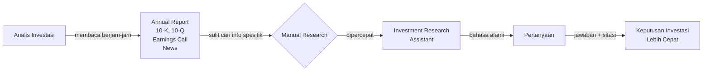

---

## 2. Goal & Success Metrics

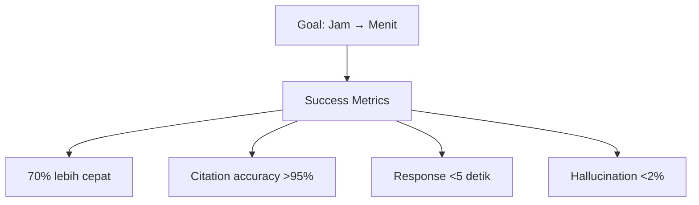

---

## 3. Target Users

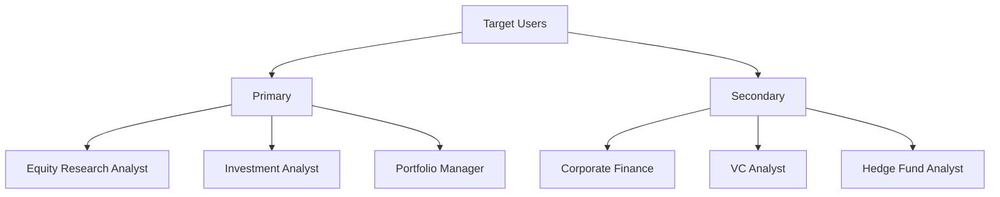

---

## 4. Data Sources

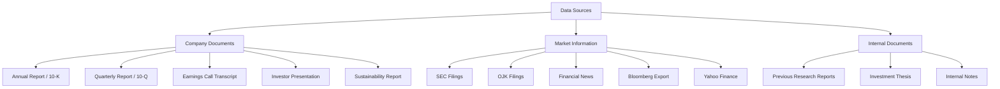

---

## 5.1 Document Ingestion

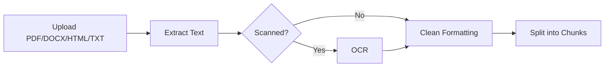

---

## 5.2 Embedding Pipeline + Metadata

```mermaid
flowchart TB
    A[Annual Report] --> C[Chunking<br/>~500 tokens]
    C --> E[Embedding Model]
    E --> V[(Vector Database)]

    V -.->. M[Metadata]
    M --> M1[Company]
    M --> M2[Year]
    M --> M3[Quarter]
    M --> M4[Page]
    M --> M5[Document Type]
    M --> M6[Section]
```

---

## 5.3 Vector Database

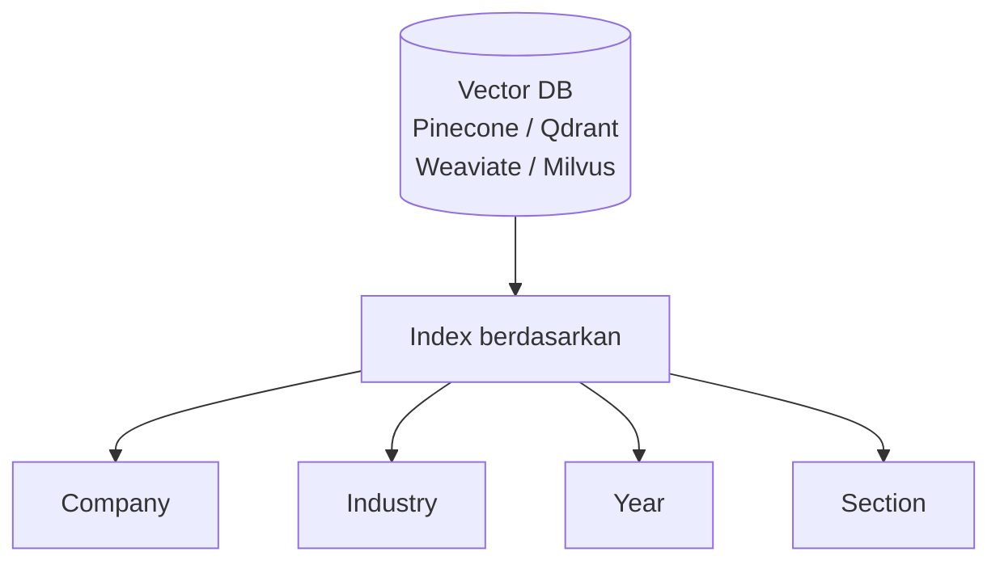

---

## 5.4 Semantic Search

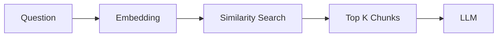

---

## 5.5 Answer Generation

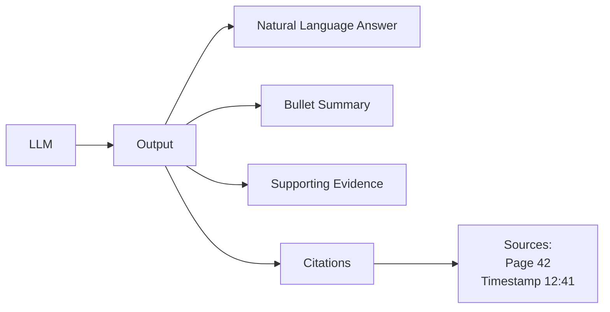

---

## 5.6 Multi-document Reasoning

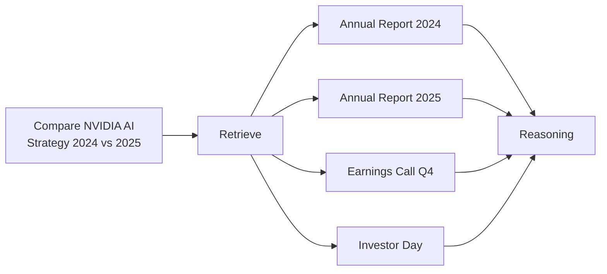

---

## 5.7–5.9 Report & Earnings Chat Features

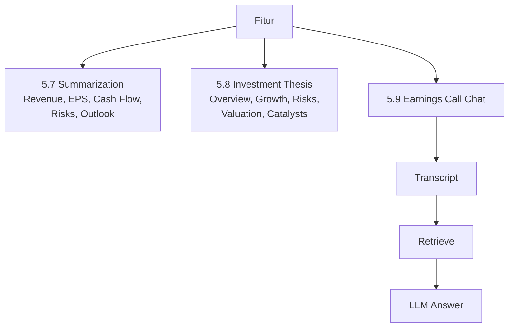

---

## 5.10 Source Citation

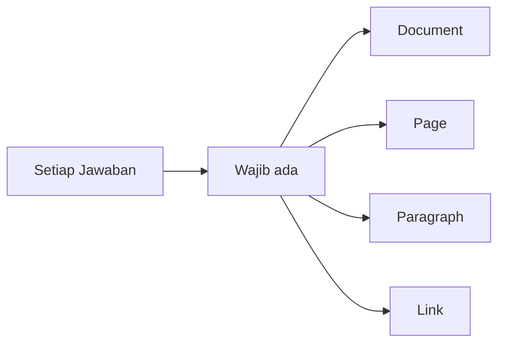

---

## 6. Non-Functional Requirements

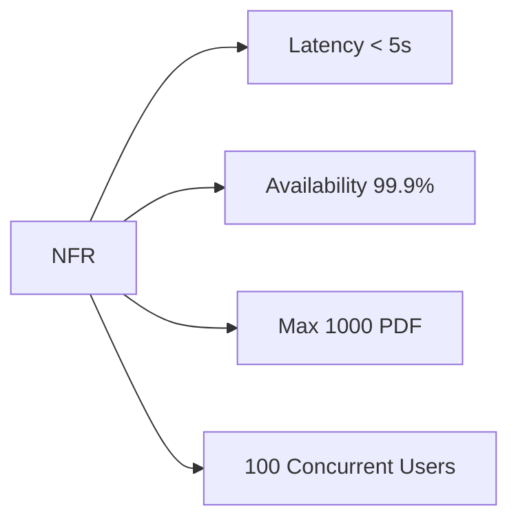

---

## 7. RAG Pipeline

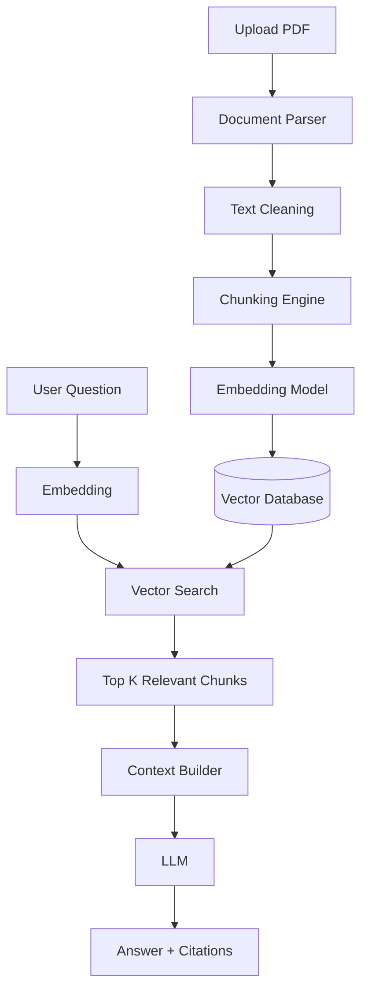

---

## 8. Recommended Tech Stack

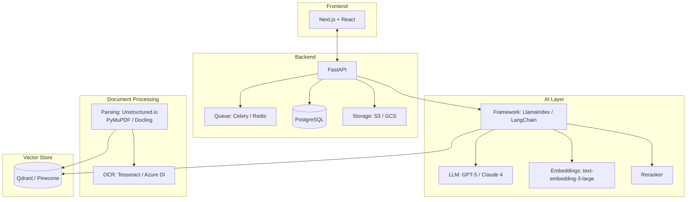

---

## 9. Future Enhancements

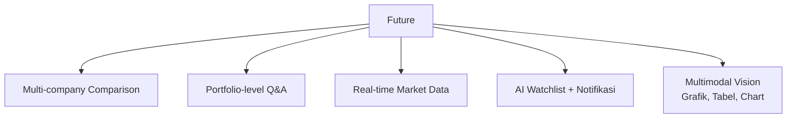

---

## Example User Journey

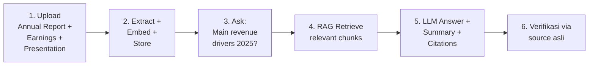

---

## V2 Architecture — Production

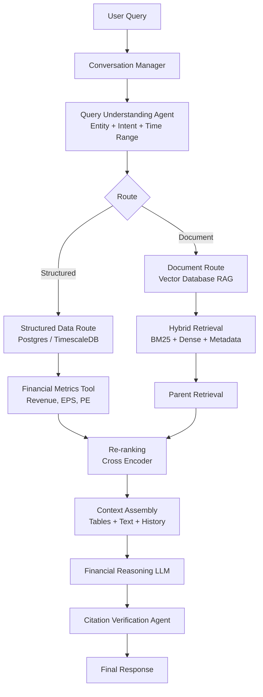

---

## V2 — Yang Diubah dari PRD

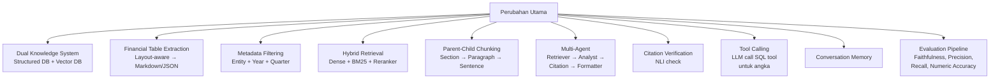

---

## V2 — Implementation Phases

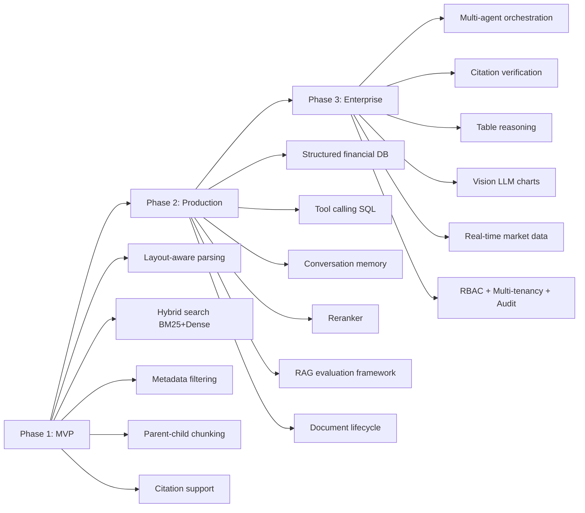
